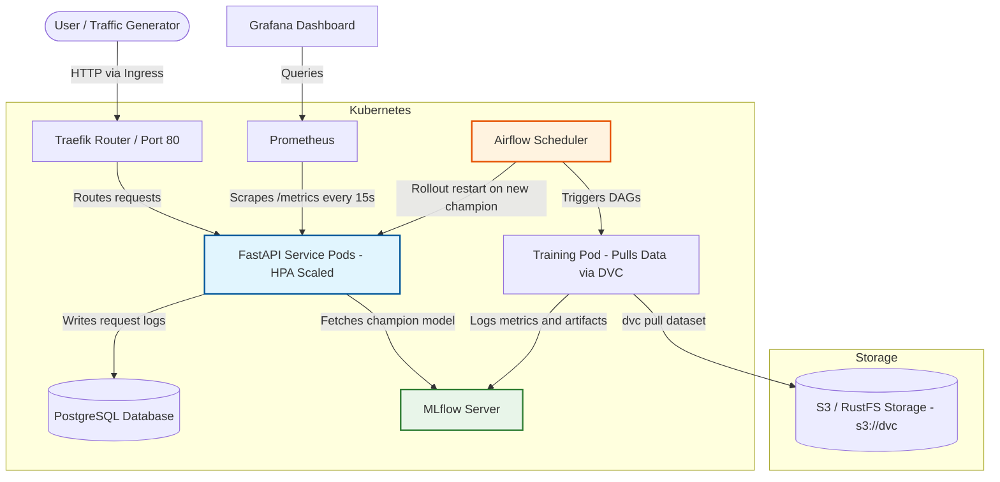

# grade_perform — ML-сервис предсказания успеваемости

FastAPI-сервис вокруг Ridge-регрессии (датасет ResearchInformation3, таргет `Overall`).

## Что это за сервис и какая модель

**Сервис.** FastAPI принимает анкету студента (Department, Gender, баллы HSC/SSC, доход, посёлок, часы подготовки, посещаемость и т.д. — схема в `src/grade_perform/features.py` с границами значений и `extra="forbid"`) и отвечает предсказанием среднего балла `Overall`: в ответе `prediction`, версия модели, `request_id` и `latency_ms`. Каждый запрос логируется строкой в Postgres. Сервис обвешан метриками Prometheus (версия модели в поде, распределение предсказаний, задержки p50/p95), живёт в kind-кластере за Traefik'ом, масштабируется HPA и переобучается по расписанию Airflow-конвейером с гейтом champion/challenger в MLflow.

**Модель.** Ridge-регрессия (sklearn Pipeline: импутация, стандартизация численных, one-hot категорийных, Ridge alpha из параметров прогона) на датасете ResearchInformation3: 482 строки, таргет `Overall` (GPA 1.0–4.0). Обучение — `src/train.py`, каждая версия регистрируется в MLflow Model Registry (`grade_perform`); новая версия всегда получает алиас `challenger`, а `champion` — только если её MAE лучше текущего чемпиона минимум на `GATE_MIN_GAIN=0.005`. Сервис грузит модель по алиасу `models:/grade_perform@champion`; если реестр пуст или недоступен — фоллбэк на joblib-файл из образа. Данные версионируются DVC и лежат в S3 кластера (RustFS), в прогонах MLflow виден `data_md5` версии данных.

## Архитектура



## Quickstart — от git clone до ответа сервиса через Ingress

Проверяющий делает `git clone` и выполняет команды сверху вниз, ничего не редактируя и не угадывая. Нужны: Docker Desktop, kind, kubectl, helm и Git Bash. Ключи S3 учебные и уже дефолтные (`dvcadmin` / `dvc-secret-123`), их менять не надо.

### 1. Платформа: кластер, MLflow, Airflow, S3, мониторинг

```powershell
& "C:\Program Files\Git\bin\bash.exe" platform/up.sh
```

Поднимает kind-кластер `sem4` с портом 80, пре-загружает образы в узел, ставит MLflow, RustFS (S3), Airflow, Traefik, Prometheus и Grafana, создаёт бакет `dvc`. Занимает 5–15 минут; повторный запуск безопасен. Проверка: `kubectl get pods -A` — всё Running; `kubectl get ingress -A` — mlflow/airflow/s3/grade-perform/grafana.localhost.

> Если Python-клиенты падают с `getaddrinfo failed` на `*.localhost` — добавьте `127.0.0.1 s3.localhost mlflow.localhost airflow.localhost` в hosts-файл.

### 2. Данные в S3 и первый champion

```powershell
uv sync
uv add "dvc[s3]"
uv run dvc remote add -d --force laptop s3://dvc
uv run dvc remote modify laptop endpointurl http://s3.localhost
uv run dvc remote add --force cluster s3://dvc
uv run dvc remote modify cluster endpointurl http://rustfs.grade-mlops:9000
uv run dvc remote modify --local laptop access_key_id dvcadmin
uv run dvc remote modify --local laptop secret_access_key dvc-secret-123
uv run dvc push
```

### 3. Первый champion в реестре

Зарегистрируйте self-hosted runner с меткой `kind` (GitHub → Settings → Actions → Runners → New self-hosted runner, Windows x64) и запустите его. Затем: Actions → ci → **Run workflow** → main. Зелёный deploy билдит образ, выкатывает сервис, кладёт DAG в Airflow и выставляет переменную `grade_perform_image`. Откройте `http://airflow.localhost`, unpause и запустите DAG `grade_perform_retrain` — после зелёных validate/train/promoted/rollout в реестре появится `grade_perform@champion`.

### 4. Ответ сервиса через Ingress

```powershell
curl.exe -s -X POST http://grade-perform.localhost/v1/predict -H "Content-Type: application/json" -d @sample_request.json
```

## Адреса интерфейсов

| Интерфейс | Адрес | Логин / пароль |
|---|---|---|
| Сервис (автодоки `/docs`) | http://grade-perform.localhost | — |
| MLflow | http://mlflow.localhost | — |
| Airflow | http://airflow.localhost | admin / admin |
| Grafana (дашборд «Grade Perform service») | http://grafana.localhost | admin / admin |
| S3-консоль (бакет `dvc`) | http://s3-console.localhost/rustfs/console/index.html | dvcadmin / dvc-secret-123 |

## Переобучение руками

Через Airflow UI: http://airflow.localhost → DAG `grade_perform_retrain` → Trigger DAG with params → `alpha` (гиперпараметр Ridge; если новая версия не лучше чемпиона — гейт её не пустит, rollout будет skipped). Расписание по умолчанию — каждый день в 03:00 Europe/Moscow (`CronTriggerTimetable`). Локально, без Airflow, валидацию данных можно запустить командой `uv run python -m grade_perform.data` (пишет прогон validate в MLflow; при нарушениях код выхода 1).

## Проверка — три команды сверху вниз

### 1. Тесты

```
uv sync
uv run pytest
```
### 2. Docker compose (api + Postgres, логи предсказаний)
```
docker compose up -d --build
Invoke-RestMethod -Uri http://localhost:8000/v1/predict -Method Post -ContentType "application/json" -Body (Get-Content -Raw sample_request.json)
docker compose exec db psql -U postgres -d grade_perform -c "SELECT * FROM predictions LIMIT 5;"
```

### 3. Kubernetes 

```
docker pull docker.m.daocloud.io/kindest/node:v1.37.0
kind create cluster --name hw1 --image docker.m.daocloud.io/kindest/node:v1.37.0
docker build -t grade-perform:hw1 .
kind load docker-image grade-perform:hw1 --name hw1
kubectl apply -f k8s/
kubectl rollout status deployment/grade-perform-api
kubectl get pods

kubectl port-forward service/grade-perform-api 8001:8000

В отдельном терминале:
Invoke-RestMethod -Uri http://127.0.0.1:8001/v1/predict -Method Post -ContentType "application/json" -Body (Get-Content -Raw sample_request.json)
```

