# Assignment 4

# 1. Платформа одной командой

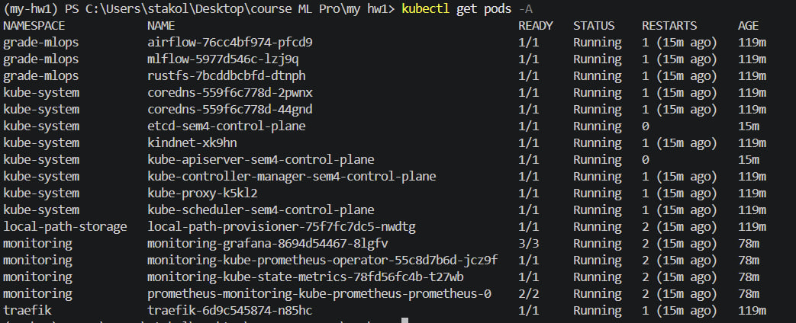

# 2. Метрики и дашборд

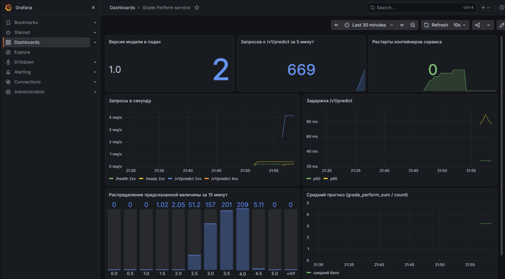

# 3 Данные в DVC и S3 кластера 

## .dvc в репо
'''
https://github.com/saakolch/ML_Pro_2026_assignment_1/tree/main/.dvc
'''

## S3

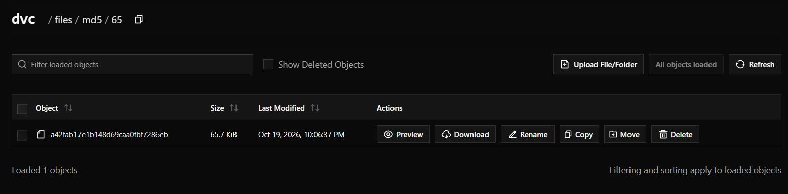

# 4 Проверка данных

## зеленый прогон 
'''
https://github.com/saakolch/ML_Pro_2026_assignment_1/actions/runs/39270604387
'''

# 5. Конвейер переобучения в Airflow

## dag 1 

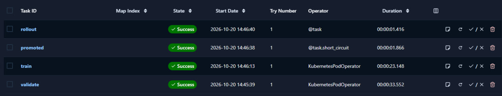

## dag 2

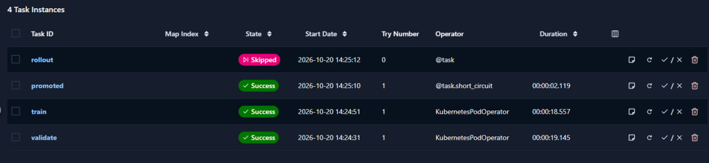

## dag 3

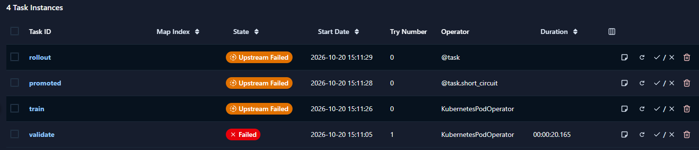

## возврат прежнего dvc поинтера и реран 

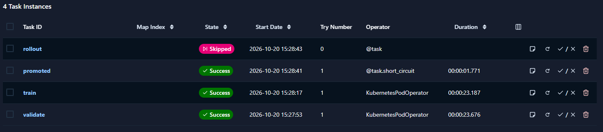

## model registry

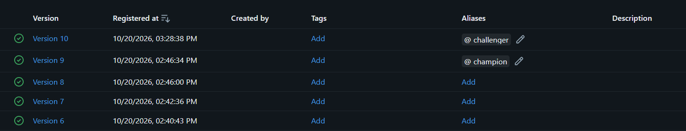

# 6. CI/CD целиком

## link

'''
https://github.com/saakolch/ML_Pro_2026_assignment_1/actions/runs/39361233422
'''

# ошибки

## внутри kind сломан DNS 

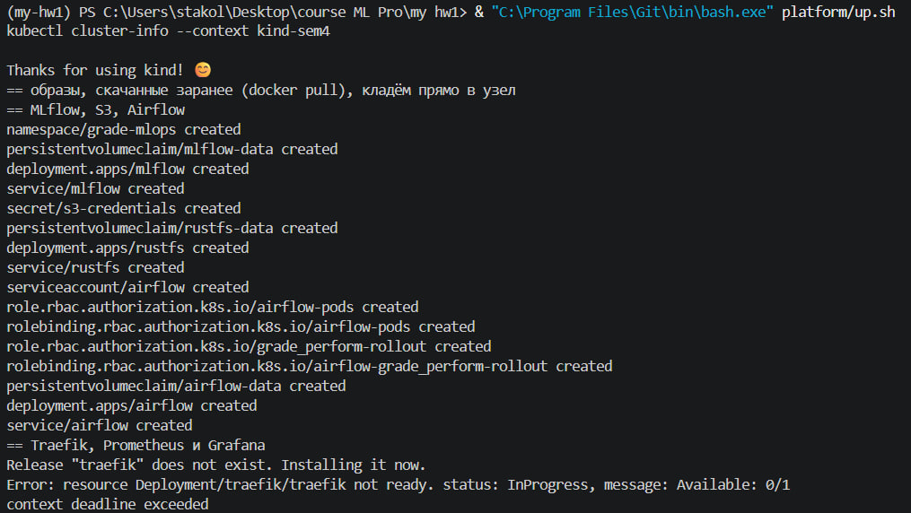

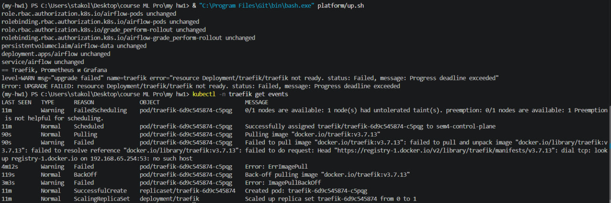

'''
надо вписать руками traefik на хост и закинуть в docker: 
docker pull traefik:v3.7.13
kind load docker-image traefik:v3.7.13 --name sem4
'''

## kind load docker-image падает на мультиплатформенных образах

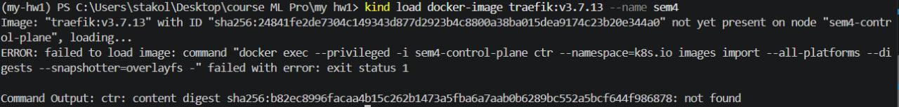

'''
сначала помещаю .tar в kind и затем запускаю скрипт - так traefik будет уже сидеть в kind до ошибки от скрипта:

docker rmi traefik:v3.7.13
docker pull traefik:v3.7.13 --platform linux/amd64
docker save --platform linux/amd64 traefik:v3.7.13 -o traefik-image.tar
kind load image-archive traefik-image.tar --name sem4
& "C:\Program Files\Git\bin\bash.exe" platform/up.sh
Remove-Item traefik-image.tar
'''

### итог

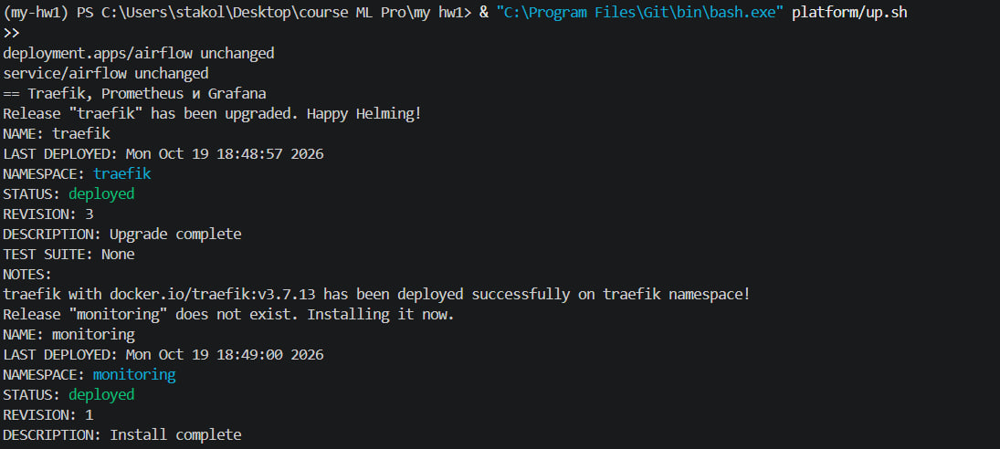

## неверный пароль при подключении к ДБ - произошла инициализация и пароль стал дефолтным

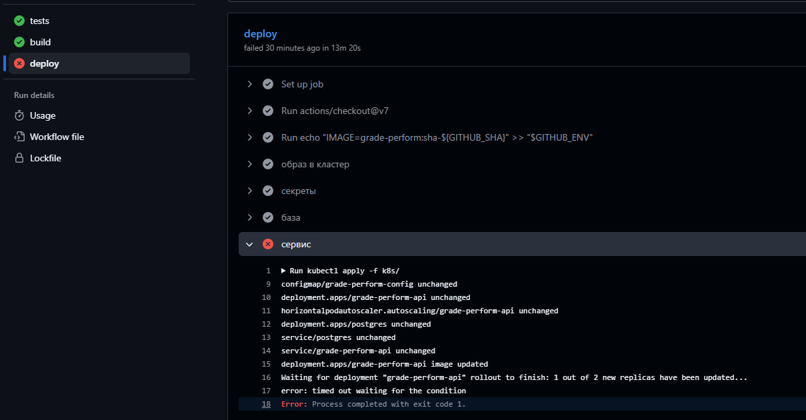

'''
перезапустил под чтобы он подтянул пароль из GitHub
'''

## снова трабл с DNS

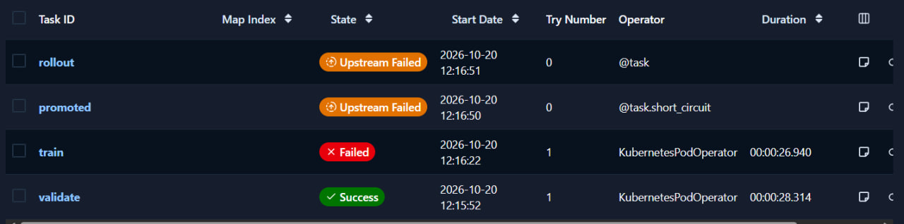

'''
PodLaunchFailedException: Image cannot be pulled, unable to start: ErrImagePull
failed to pull and unpack image "docker.io/library/alpine:3.24.1": failed to resolve reference "docker.io/library/alpine:3.24.1": failed to do request: Head "https://registry-1.docker.io/v2/library/alpine/manifests/3.24.1": dial tcp 108.160.165.48:443: connect: connection refused
'''

'''
-> взять ту же тактику как раньше:
docker pull alpine:3.24.1 --platform linux/amd64
docker save --platform linux/amd64 alpine:3.24.1 -o "$env:TEMP\alpine.tar"
kind load image-archive "$env:TEMP\alpine.tar" --name sem4
Remove-Item "$env:TEMP\alpine.tar"
'''

# Ответы

1. У вас в реестре версия N модели. По шагам: как восстановить ровно тот код и те данные, на
которых она обучена? Какие поля прогона MLflow и какие файлы в git для этого нужны?

'''

'''

2. Почему данные не в образе, а указатели в образе? Что сломается, если сделать git push
раньше dvc push, и где вы это увидите?
3. Какие проверки вашей схемы бинарные, а какие с порогом? Как выбирали порог и что будет,
если он слишком строгий?
ML PRO · домашнее задание 4 · итоговый проект 5
4. Чем проверка pandera в конвейере отличается от Pydantic‐схемы в сервисе? Зачем нужны
обе?
5. Почему обучение идёт в отдельном поде из образа сервиса, а не внутри Airflow? Почему
выкат новой модели не требует пересборки образа?
6. Какие метрики на вашем дашборде про инфраструктуру, какие про сервис, какие про мо‐
дель? Почему request_id нельзя класть в метку Prometheus?
7. Что происходит с подами и с запросами во время выката новой модели? Зачем preStop и
что вы видели без него?
8. Какой отказ вашего проекта в проде самый вероятный? Где и через сколько вы его заметите
и что сделаете первым?